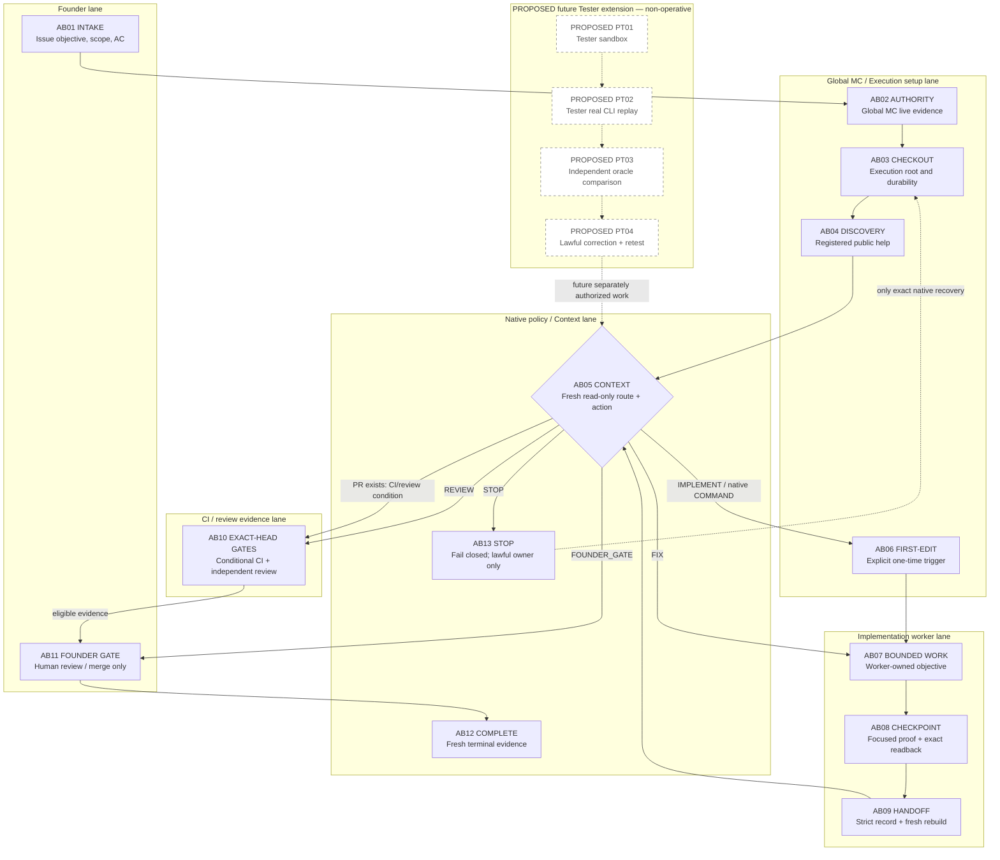

# Bemoat Harness Flow Blueprint

Child B of [Issue #642](https://github.com/bemoat/bemoat-web-starter/issues/642)
is a concise descriptive reference for the current Founder–Agent harness flow.
It is an `AS_BUILT` description, not policy, a router, a scheduler, a state
ledger, a permission engine, or an authorization record. Canonical merged policy,
registered CLI contracts, fresh `bemoat:context`, durable Git/GitHub evidence,
and the applicable Issue scope remain authoritative.

## Authority, freshness, and source links

The authority order is: merged protected-main policy and loader; registered
public CLI contract and fresh Context; durable repository/Issue/PR/CI/review
evidence; current story-first contracts; then this descriptive artifact. A
copied source, this Blueprint, or the oracle cannot manufacture `COMMAND`,
`COMPLETE`, a Founder decision, a review, a merge, or a next objective.

| Source | Protected-base identity | Exact source/blob link | Use in this Blueprint |
| --- | --- | --- | --- |
| `docs/mission-control/mission-control-guide.md` | `d587ff2c6ac4a314b193e321613c3299c83b6da5` | [policy at `89d5eaa`](https://github.com/bemoat/bemoat-web-starter/blob/89d5eaaac02bc8ac24ea27c3a8900c6ce6abc610/docs/mission-control/mission-control-guide.md) | Canonical policy: current protocol, ownership, gates, durability, child sync, historical evidence. |
| `prompts/mission-control/chatgpt-project-loader.md` | `bab021b898743e06a1f4c31b335f588bbc358946` | [live policy router](https://github.com/bemoat/bemoat-web-starter/blob/89d5eaaac02bc8ac24ea27c3a8900c6ce6abc610/prompts/mission-control/chatgpt-project-loader.md) | Global/Execution separation, route handling, and no-autonomous-merge boundary. |
| `docs/mission-control/command-reference.md` | `a6d19adab4f7b171dd90110f7637929dbf9c201e` | [command reference](https://github.com/bemoat/bemoat-web-starter/blob/89d5eaaac02bc8ac24ea27c3a8900c6ce6abc610/docs/mission-control/command-reference.md) | Context, recovery, review, Handoff, and stop contracts. |
| `docs/mission-control/execution-handoff-contract.md` | `c0d972299ee5b64c396db7633f9e638487048aa9` | [Execution contract](https://github.com/bemoat/bemoat-web-starter/blob/89d5eaaac02bc8ac24ea27c3a8900c6ce6abc610/docs/mission-control/execution-handoff-contract.md) | First-edit, worker ownership, exact recovery, conditional gates, and fresh reconstruction. |
| `docs/agent-loop/context-story-matrix.md` | `f9f2712dfed8a8c1a2c10117a376e0c524a057f4` | [story matrix](https://github.com/bemoat/bemoat-web-starter/blob/89d5eaaac02bc8ac24ea27c3a8900c6ce6abc610/docs/agent-loop/context-story-matrix.md) | Canonical invariant/oracle discipline and bounded route stories. |
| `docs/agent-loop/issue-driven-branch-workflow.md` | `e687ac27dc7fe31f371412a48139f8323b8a0ffc` | [issue workflow](https://github.com/bemoat/bemoat-web-starter/blob/89d5eaaac02bc8ac24ea27c3a8900c6ce6abc610/docs/agent-loop/issue-driven-branch-workflow.md) | Preflight, first-edit trigger, validation, durability, and handoff gates. |
| `docs/agent-loop/role-handoff-contract.md` | `17020df9d1e38a2ba4fd9b6b4f46aca8745a6f32` | [Handoff transport](https://github.com/bemoat/bemoat-web-starter/blob/89d5eaaac02bc8ac24ea27c3a8900c6ce6abc610/docs/agent-loop/role-handoff-contract.md) | Strict append-only transport and route vocabulary. |
| Child A evidence | Issue #641 HANDOFF comment `6126430652` | [Child A durable characterization](https://github.com/bemoat/bemoat-web-starter/issues/641#issuecomment-6126430652) | Read-only authority/legacy/F01–F06/host-feasibility constraints; not executable authority. |
| Founder design evidence DD01–DD03 | Issue #637 comment `6119109505` | [DD01–DD03](https://github.com/bemoat/bemoat-web-starter/issues/637#issuecomment-6119109505) | Objective/ownership and independent-evidence constraints. |
| Founder design evidence DD04–DD06 | Issue #637 comment `6119352524` | [DD04–DD06](https://github.com/bemoat/bemoat-web-starter/issues/637#issuecomment-6119352524) | Blueprint/oracle boundary, archive-first disposition, and Tester-tier constraints. |
| Founder design evidence DD07–DD09 | Issue #637 comment `6119483283` | [DD07–DD09](https://github.com/bemoat/bemoat-web-starter/issues/637#issuecomment-6119483283) | Remaining publication, provenance, and unresolved-gap constraints. |

The embedded #642 startup Context is a **session readback only**: it was
mutation-free at the same protected base, with route `IMPLEMENT`, native
`next_action.type` `COMMAND`, clean durable branch
`docs/642-harness-flow-blueprint`, and no active PR. It is non-authoritative
after publication and must be rerun as fresh native Context after any durable
result; this file does not preserve or grant its action.

Machine-readable companion: [flow-oracle.json](./flow-oracle.json). It is
verification-only and independently sourced; it cannot derive a route action or
grant a command, completion, review, merge, or next objective.

## Stable `AS_BUILT` graph

The IDs below are stable names for one graph. Founder and Agent views are
projections of these same IDs; they are not separate workflows. Route and
`next_action` are independently observed from fresh Context: a route label
never computes an action.

`AB01`–`AB13` are current `AS_BUILT` descriptions. `PT01`–`PT04` are
explicitly `PROPOSED`: they do not exist as a runtime, do not add a route, and
cannot be used to claim Tier-1 or Tier-2 proof. A successful objective does not
authorize Objective N+1; new scope requires its own lawful scope/authority and
fresh Context.

## Founder projection

| Step ID | Founder sees or decides |
| --- | --- |
| `AB01` | The fixed Issue objective, scope, dependencies, and acceptance criteria. |
| `AB02` | Global MC’s live identity and destination preparation; Global MC does not execute the objective or choose a route. |
| `AB03`–`AB05` | Execution/IDE preflight, registered CLI contract, and fresh Context evidence; no plan or diagram grants authority. |
| `AB06`–`AB09` | The explicit first-edit trigger, worker-owned bounded progress, exact durable checkpoint, strict Handoff/readback, and fresh reconstruction. |
| `AB10` | Conditional exact-head CI and independent semantic review; a new head invalidates stale proof. |
| `AB11` | The human decision boundary and manual merge; Founder approval does not authorize an agent to merge. |
| `AB12` | Terminal `COMPLETE` only after native merged evidence and fresh Context. |
| `AB13` | A fail-closed blocker and its evidence-backed lawful owner; do not infer Founder approval from `STOP`. |

## Agent projection

| Step ID | Agent action boundary |
| --- | --- |
| `AB01` | Consume, never rewrite, the fixed Issue objective and scope. |
| `AB02` | Reconstruct live repository/base/policy/Issue/PR/head evidence; remain orchestration-only when acting as controller. |
| `AB03`–`AB04` | Verify the clean durable checkout and run only registered CLI Discovery; setup is not objective authority. |
| `AB05` | Run fresh Context and inspect both native route and native action independently. |
| `AB06` | Wait for the one-time implementation trigger after preflight; without it, do not edit source files. |
| `AB07` | The distinct implementation worker is the sole mutation owner for the bounded scope; controller, Tester, and oracle do not mutate it. |
| `AB08`–`AB09` | The implementation worker alone makes the checkpoint and Handoff mutation; focused proof/readback may be reported by a verifier, but reviewer/verifier correction is forbidden. |
| `AB10` | Verifier/reviewer only verifies and reports exact-head CI/review status; any correction returns to the implementation worker through fresh native Context. |
| `AB11`–`AB12` | Stop at Founder merge and fresh terminal evidence; never merge or self-approve. |
| `AB13` | Stop fail-closed, or perform only the exact recovery freshly prescribed by native Context; do not invent a fallback. |

## Transition matrix

| Step ID | Actor / owner | Preconditions | Allowed effects | Forbidden effects | Proof / readback | Failure class | Next lawful owner |
| --- | --- | --- | --- | --- | --- | --- | --- |
| `AB01` | Founder / Issue owner | Issue exists with fixed objective, scope, dependencies, and AC. | Define the bounded objective before execution. | Dynamic insertion, reorder, skip, self-advance, or Issue mutation by an agent. | Live Issue readback. | `SCOPE_CONFLICT` or `SPEC_GAP`. | Global MC / Founder scope owner. |
| `AB02` | Global MC, orchestration-only | Live repository, protected base, merged loader/policy, Issue, and relevant PR/head evidence. | Prepare one destination-specific objective handoff. | Execute objective work, route Context, mutate files, or grant authority. | Live GitHub/native Git identity readback. | `BLOCKED_EXTERNAL`, `STATE_CONFLICT`. | Execution/IDE MC for Discovery and fresh Context. |
| `AB03` | Execution/IDE setup owner | Canonical clean durable Issue checkout, exact branch/upstream, and applicable Section 12 case. An exact-SHA detached protected-main command source is supported; only an unsupported, dirty, or non-durable target state is a setup STOP. | Perform only bounded dependency setup or exact native workspace recovery. | Pull, reset, rebase, stash, edit objective files, or infer a route. | HEAD/branch/upstream/base/manifests/tracked-clean readback. | `LOCAL_STATE_NOT_DURABLE`, `EVIDENCE_CONFLICT`. | Execution/IDE MC. |
| `AB04` | Execution/IDE MC | Setup predicates pass. | Run registered `--help --json` and inspect the declared contract. | Invoke internal functions, bypass Discovery, or treat help as authority. | Machine-readable help, mutation-free. | `CLI_DISCOVERY_DEFECT`, `INVALID_INVOCATION`. | Execution/IDE MC for `AB05`. |
| `AB05` | Native `bemoat:context` | Registered contract and fresh live evidence available. | Compute one native route and independently return its native action. | This Blueprint/oracle computing an action, granting `COMMAND`/`COMPLETE`, or choosing evidence by timestamp/order. | `mutation_performed:false`, exact Context JSON, issue/base/policy/head identity. | `STOP`, `BLOCKED_EXTERNAL`, `EVIDENCE_CONFLICT`. | Native Context’s stated owner/action only. |
| `AB06` | Authorized implementation worker | Fresh Context authorizes work and the post-preflight trigger is explicit. | Begin the one bounded objective edit. | Edit before trigger, broaden scope, or delegate mutation to controller/oracle/Tester. | First-edit trigger and diff/status readback. | `CONTRACT_VIOLATION`, `SCOPE_CONFLICT`. | Implementation worker. |
| `AB07` | Distinct implementation worker | One authorized objective, worker scope, and no unresolved gate. | Make the smallest in-scope change and coupled proof. | Controller self-implementation, runtime router, scheduler, ledger, policy duplicate, production/secret/migration work. | Focused test/proof, status, diff. | Implementation defect or `SPEC_GAP`; never a guessed fallback. | Implementation worker until proof, otherwise native owner. |
| `AB08` | Implementation worker only | Focused proof passes for a coherent unit. | The implementation worker alone commits/pushes the proven unit when durable evidence is required and reads back exact remote SHA. | Reviewer/verifier correction mutation, knowingly broken durability, lost WIP, or claiming durability without remote readback. | Exact HEAD, upstream, remote branch, clean status, proof result; verifier may report only. | `LOCAL_STATE_NOT_DURABLE`, `HEAD_DRIFT`. | Handoff owner / fresh Context. |
| `AB09` | Implementation worker / native Handoff command | Durable result and applicable strict schema are ready. | The implementation worker appends one validated Handoff and verifies exact readback; rerun fresh Context. | Multiple transports, reviewer/verifier mutation, prose-only authority, or using Handoff as new permission. | Exact native comment body/id/url and fresh Context. | `INVALID_INVOCATION`, `STATE_CONFLICT`. | Fresh Context. |
| `AB10` | Deterministic verifier + independent reviewer | Active PR and exact current head; conditional CI/review requirements apply. | Verify and report exact-head CI and independent semantic/Delta review only; route any correction to the implementation worker through fresh native Context. | Reviewer/verifier correction mutation, stale-head proof, self-review, or bypass of required checks. | CI/check and submitted native review bound to exact head. | `VERIFY`, `FIX`, or `REVIEW` per native Context. | Implementation worker through native Context, or native route owner. |
| `AB11` | Founder | Native evidence reaches the human gate and all conditional requirements pass. | Decide and manually merge according to protected repository policy. | Agent merge, autonomous approval, or treating a gate as a worker command. | Founder decision, native merge evidence, exact PR/base/head. | `FOUNDER_GATE` until decision; otherwise `STOP`. | Founder, then fresh Context. |
| `AB12` | Native Context / Founder readback | Valid merged PR and merge commit are live; no competing evidence. | Observe terminal `COMPLETE`. | Blueprint/oracle declaring completion or starting another objective. | Fresh Context with current merged evidence. | `STATE_CONFLICT` or `STOP` if terminal evidence is ambiguous. | Founder/Global MC for a new Issue only. |
| `AB13` | Native Context; blocker-specific owner | Required evidence is missing, stale, conflicting, or unsupported. | Preserve state and follow only exact native recovery or named resolution. | Retry unchanged STOP, invent a route, mutate at STOP/FOUNDER_GATE, or infer Founder approval. | Blocker identity, native route/action, and post-recovery fresh Context. | `STOP`, `BLOCKED_EXTERNAL`, `EVIDENCE_CONFLICT`. | The owner named by live evidence; otherwise operator/Founder boundary. |

## Conditional CI, review, merge, STOP, and Founder ownership

- CI and semantic review are conditional on an active PR and the applicable
  workflow profile. They must bind to the exact current PR head; a new commit
  requires fresh exact-head proof. Missing/pending CI or review is not permission
  to merge.
- `FOUNDER_GATE` is a human decision boundary. Founder owns the decision and
  manual merge; no controller, implementation worker, Tester, oracle, or
  automation may satisfy it. After a decision, fresh Context is required.
- `STOP` is native fail-closed evidence, not a request to guess or retry. The
  next owner is only the owner named by current evidence or an exact recovery
  command from fresh Context. A generic STOP does not imply that Founder
  approval is required.
- A strict Handoff records a durable snapshot and route; it creates no state
  machine, permission, review, merge, or next-objective authority.
- An exact-SHA detached protected-main command source is supported by the
  current contract; detachment alone is not a STOP. Only an unsupported,
  dirty, or non-durable target state stops setup. For an active PR on a
  numbered branch, a local branch-number spelling difference is not a STOP
  when the live PR branch, exact head, base, repository, and Issue ownership
  all match; identity mismatch remains fail-closed.
- Stale review by itself is not `STOP` when fresh exact-head CI on a new head
  canonically requires `REVIEW`. `STOP`-04 is reserved for malformed,
  competing, or wrong-identity evidence that cannot be bound to one exact
  head.

## Publication validation and completion gates

This publication is complete only after evidence is actually produced for every
applicable gate. Required proof is: focused Blueprint/oracle syntax, structure,
stable-ID, provenance, and action-independence checks; the full required tier
`pnpm run check`; exact-head CI; independent review; an acceptance-criteria
audit; strict `bemoat:handoff` publication and readback; and fresh Context after
the durable result. Final delivery evidence is **PENDING** in this working
tree: this Child B publication claims none of CI, merge, review completion, or
HANDOFF publication until those native gates are run and read back.

## Legacy consumers, provenance, and disposition

This is an inventory and routing aid, not an archive operation. **Archive-first**
means: confirm consumers and owner, add a backlink to this Blueprint in a
separately authorized change, preserve immutable provenance, then archive or
deprecate only after the owner verifies no active contract depends on the file.
No legacy file is moved or deleted by #642.

| Path / record | Classification | Active consumers found in read-only characterization | Provenance / conflict | Disposition |
| --- | --- | --- | --- | --- |
| `docs/mission-control/mission-control-guide.md` | `ACTIVE_CANONICAL` | Loader, Context/Handoff code, guards, integration tests, AGENTS. | Protected-main policy v1.7.0; exact source link above. | Keep canonical; never archive from this Blueprint. |
| `docs/mission-control/command-reference.md`, `execution-handoff-contract.md`, and loader | `ACTIVE_CANONICAL` | Mission-control README, loader, CLI contract tests, execution/transfer docs. | Exact protected-main blobs listed above. | Keep canonical; no duplicate policy text. |
| `docs/agent-loop/role-handoff-contract.md` | `ACTIVE_CANONICAL` | AGENTS, Context recovery, publication/template tests, boilerplate manifest. | Current compact transport; older comments are migration evidence only. | Keep canonical; do not replace with this Blueprint. |
| `docs/agent-loop/issue-driven-branch-workflow.md` and `project-progress-tracking.md` | `CURRENT_SUPPORTING` | AGENTS, agent-loop README/checklist, Issue template, PR template, issue-intake docs. | Current branch/durability and project-progress guidance. | Keep supporting; archive only after owner-led consumer migration. |
| `docs/agent-loop/operating-manual.md` | `CURRENT_SUPPORTING` / legacy manual | Starter reading order, agent-loop README, Composer prompt, knowledge/ADR/starter docs, migration guide, checkpoint guidance test. | Older v1 manual remains linked and consumed; it is not authority over merged policy. | Archive candidate only after backlinks and all consumers are migrated by the owning scope. |
| `docs/agent-loop/state-template.md` and `roles.md` | `CURRENT_SUPPORTING` / local-session legacy | Agent-loop README/checklist and roles/manual navigation; state template is local/session recovery only. | Historical role/state vocabulary; not a current route or ledger. | Preserve provenance; archive-first after owner confirms consumer removal. |
| Historical `RESULT`, `REVIEW_VERDICT`, and managed-state records | `HISTORICAL_EVIDENCE` | Context compatibility readers and migration-boundary tests. | Mission-control guide and command reference explicitly limit them to read-only migration evidence. | Never rewrite/delete as part of #642; retain immutable history. |

The current navigation/index owner is `docs/mission-control/README.md`; no
navigation, sync, or test file is changed here because the existing contracts
do not require a second router or a generated/managed artifact. Any future
backlink or archive operation needs its own lawful scope, owner, and fresh
Context.

## Explicit future boundary

`PT01`–`PT04` describe a future Tester extension only: an actually spawned
host, isolated disposable resources, real public CLI, independent oracle
comparison, reproducible defect transfer to the authorized implementer, and
independent retest. Child C owns that work. Until separately authorized and
proven, the host capability is `UNREACHABLE`; the proposed nodes do not change
the `AS_BUILT` graph or any route, gate, owner, or next action.
